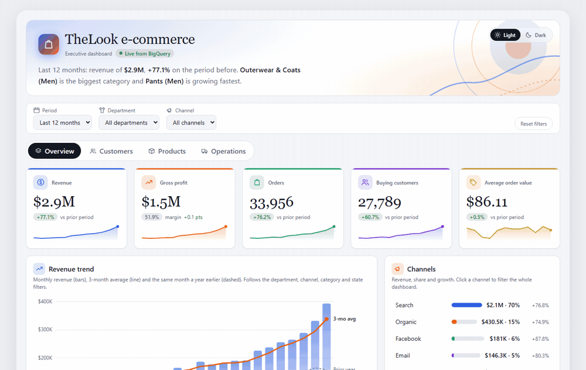
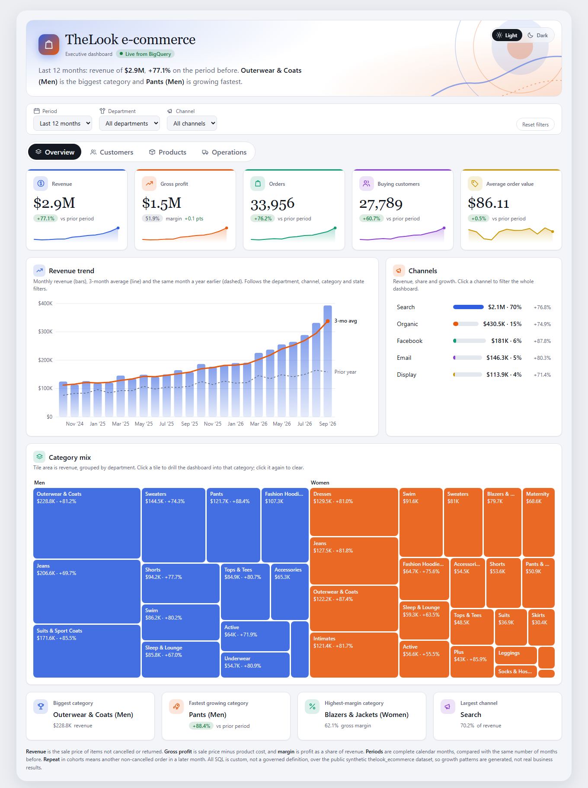
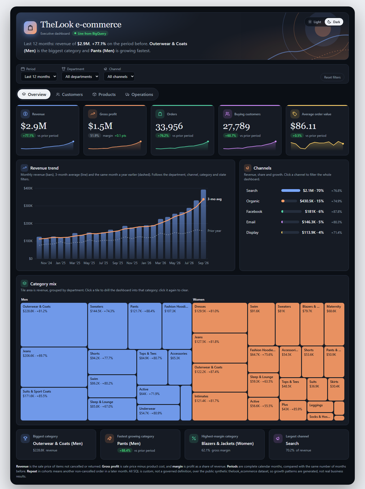
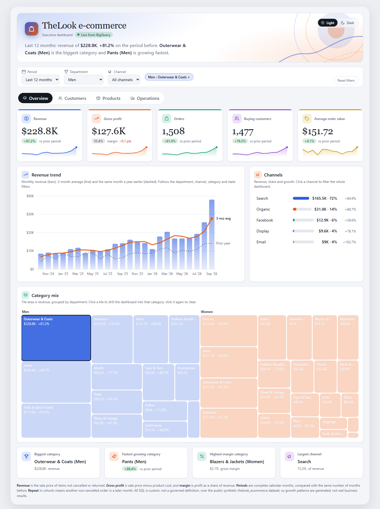
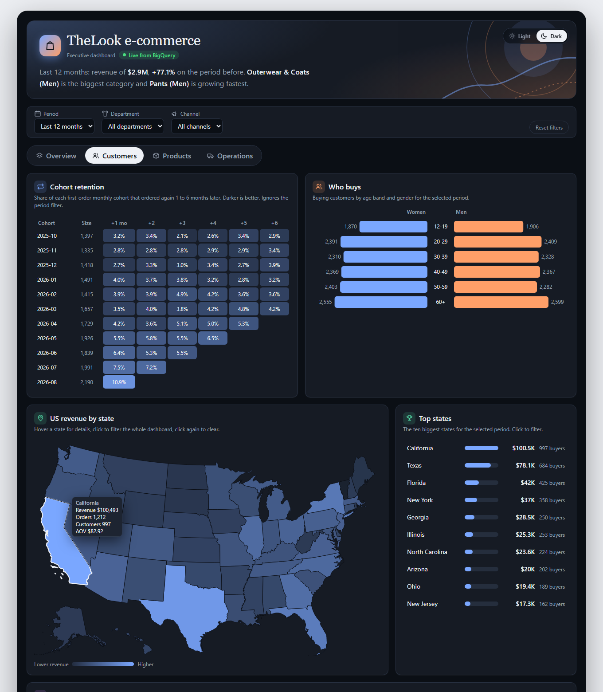
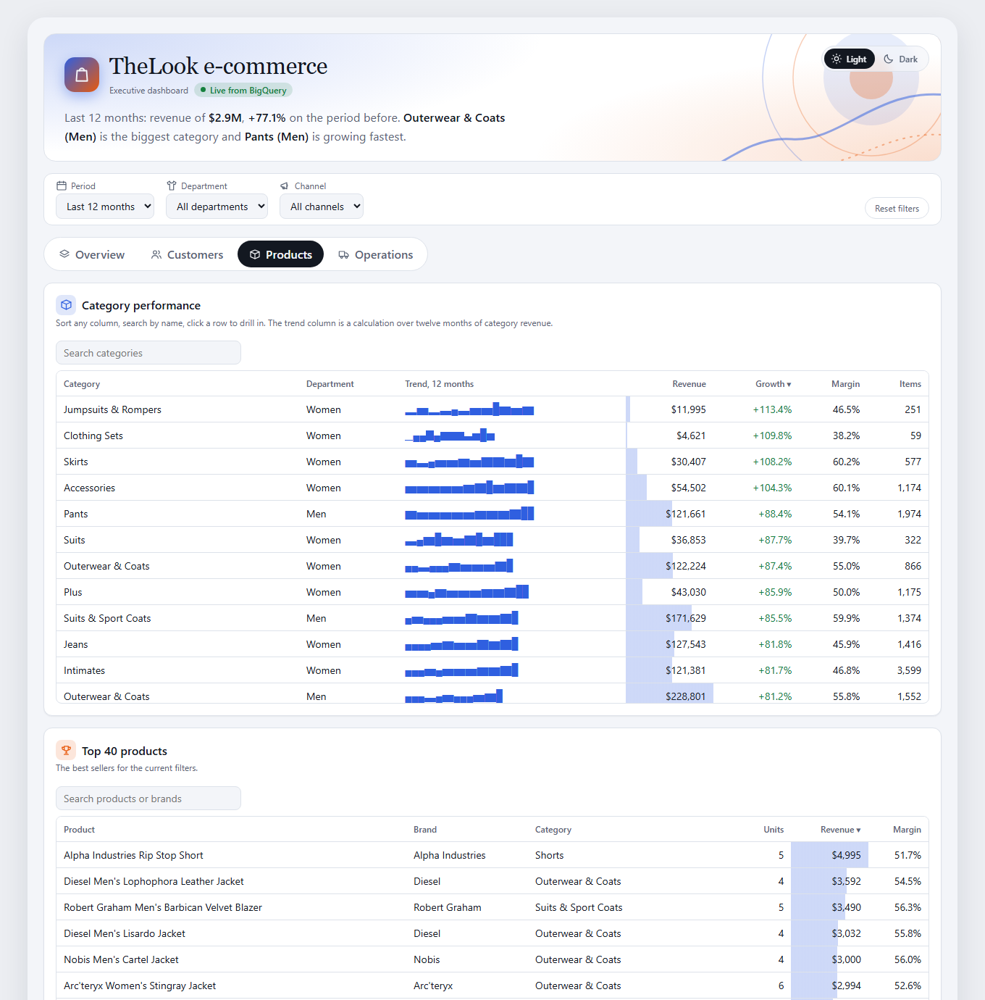
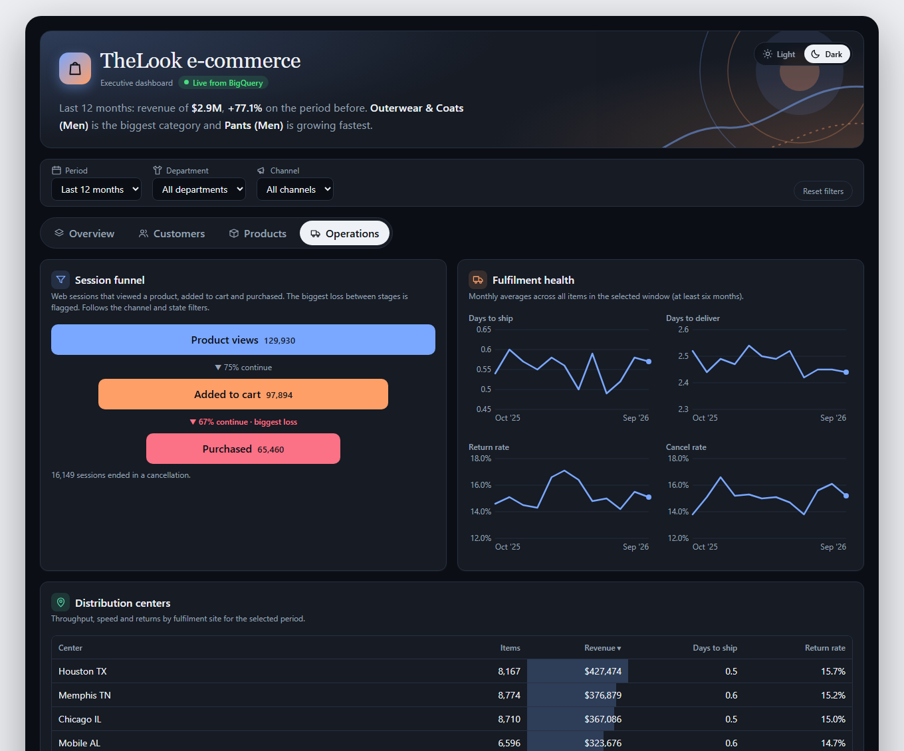

# TheLook E-commerce: an executive dashboard built with Claude Dashboards

An interactive, multi-tab executive dashboard over a live BigQuery warehouse, built with Anthropic's **Claude Dashboards** (beta, launched October 2026). Every number is a live query you can click through to see its SQL.

The point of the project is to find out what Claude Dashboards is actually good for, where it stops, and how a dashboard like this fits next to Tableau or Power BI.



| | |
|---|---|
|  |  |
|  |  |
|  |  |

*Captured on 2026-10-13 from the dashboard's page source, rendered against a snapshot of the live BigQuery results: the default view plus one drill-down (Men, Outerwear and Coats). Inside Claude Dashboards the same page queries BigQuery live and adds the Sources panel, sharing and comments.*

## What it does

| Tab | What's on it |
|---|---|
| **Overview** | Five KPI cards with change vs the prior period and sparklines, revenue trend with 3-month average and prior-year overlay, channel mix, category treemap, calculated leaders (biggest, fastest-growing, highest-margin category, largest channel) |
| **Customers** | First-order cohort retention heatmap, age and gender butterfly chart, US choropleth map by state, top states, top markets |
| **Products** | Sortable, searchable category table with a 12-month trend column and in-cell bars, top 40 products |
| **Operations** | Session funnel with the biggest drop flagged, fulfilment trends (days to ship and deliver, return and cancel rates), distribution-center table |

**Self-service on the page**

- Global filters for period, department and channel, with a reset.
- Click-to-filter: click a treemap tile, channel bar or map state and every card re-queries. Active selections show as removable chips.
- Hover details on charts, sortable and searchable tables.
- Click any number to see the query behind it, then download the rows as CSV from the Sources panel.
- Light and dark theme switch for presenting.

## How it was built

1. Created a free BigQuery project (sandbox mode, no billing) and queried `bigquery-public-data.thelook_ecommerce` directly.
2. Connected Claude to BigQuery with the Google Cloud BigQuery connector.
3. Described the dashboard I wanted. Claude wrote the live SQL datasets, the calculations and the page, and I iterated on it in conversation.
4. Every query was run against BigQuery before it went into the dashboard, then reviewed.

The 15 queries are in [`queries/`](queries). Four values are calculations rather than SQL: change vs prior period, category leaders, the category trend sparkline and funnel conversion.

The page itself (layout, charts, interactions, theme switch) is in [`dashboard/`](dashboard): `index.html` is the page source and `usmap.js` is the embedded state outlines. It runs inside Claude Dashboards, which supplies the data and filter runtime, so it is not a standalone web page.

## Definitions

- **Revenue**: sale price of items not cancelled or returned.
- **Gross profit / margin**: sale price minus product cost, and profit as a share of revenue.
- **Periods**: complete calendar months, compared with the same number of months immediately before.
- **Repeat**: a customer with another non-cancelled order in a later month.
- The funnel starts at product view, because sessions can begin on any page and a home-to-purchase funnel is not monotonic in this data.
- Duplicate country names (`Brasil`/`Brazil`, `Deutschland`/`Germany`, `España`/`Spain`) are merged in SQL.

## What I learned

**Where it's strong**

- Question to a live, auditable dashboard in about an hour. The query behind each number is one click away, which a chat answer or screenshot can't give you.
- Good for prototyping metrics and layout with stakeholders before committing to a BI build. The dashboard type can rebuild itself in another tool through that tool's connector.
- Queries run under each viewer's own access, so there's no shared service account quietly exposing data.

**Where it isn't a Tableau or Power BI replacement**

- It lives as a page in Claude and is shared from there. It isn't something you host or embed for anonymous customers, and live queries need each viewer to have access to the data source.
- No governed metric layer, row-level security or audit trail of its own.
- Each viewer re-runs the queries, so it suits small teams, not wide distribution.
- No scheduled email or PDF distribution that I could find.

**Practical notes**

- The map needs state outlines embedded in the page, because a dashboard page can't fetch external map data and ships no geometry. I used the public-domain `states-albers-10m` file from the [us-atlas](https://github.com/topojson/us-atlas) package (US Census boundaries).
- Dataset caveat: thelook is synthetic, so the steady growth and flat repeat rates are generated patterns, not business findings.

## Reproduce it

1. Create a Google Cloud project and open BigQuery (sandbox mode needs no billing).
2. Confirm access by running this in the BigQuery console:

   ```sql
   SELECT COUNT(*) FROM `bigquery-public-data.thelook_ecommerce.orders`
   ```

3. In Claude, connect the Google Cloud BigQuery connector, then ask for a multi-tab executive dashboard over `thelook_ecommerce`. The SQL in [`queries/`](queries) is a starting point.

See [`DEMO_SCRIPT.md`](DEMO_SCRIPT.md) for the recording walkthrough.

## Stack

BigQuery (public dataset, sandbox) · Claude Dashboards · d3 for charts · SQL
